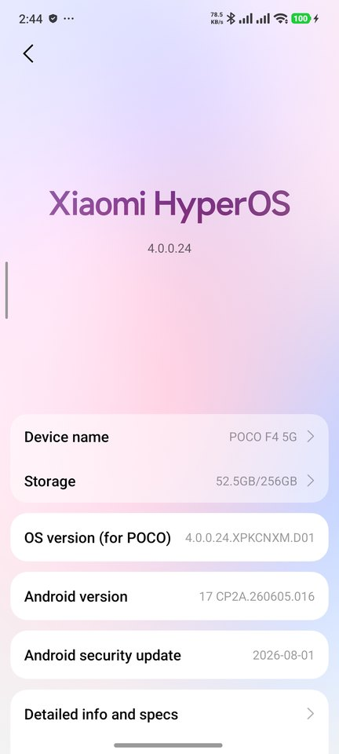
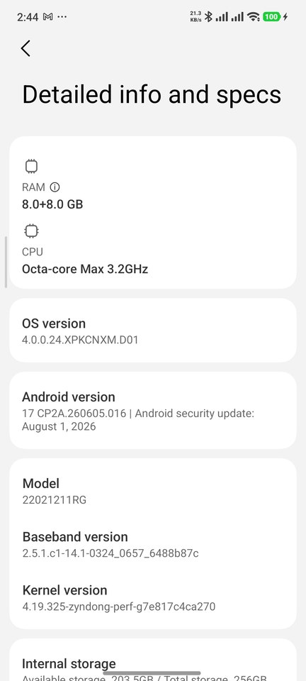
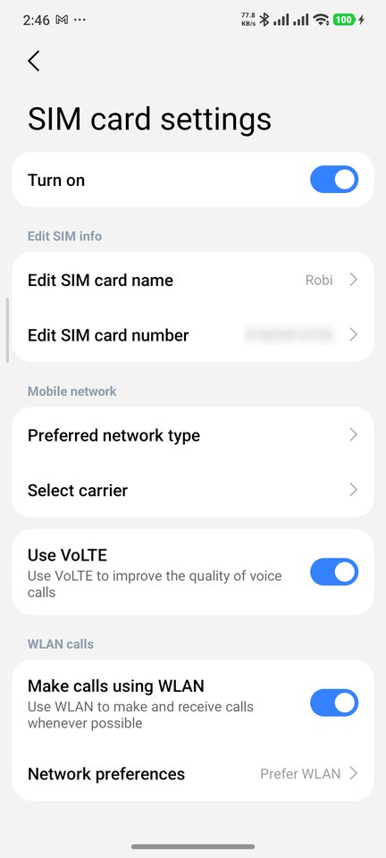
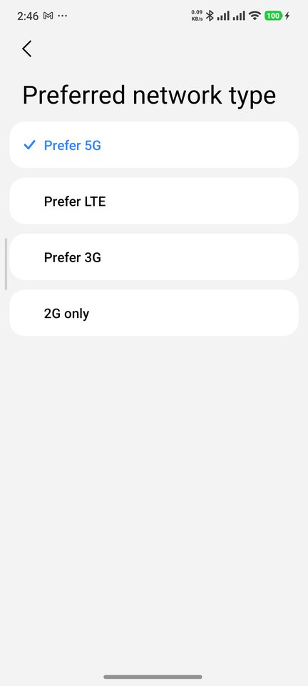
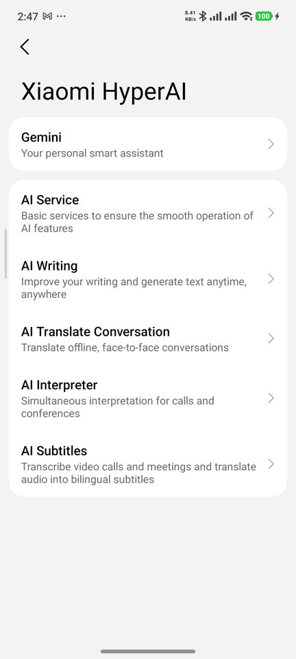
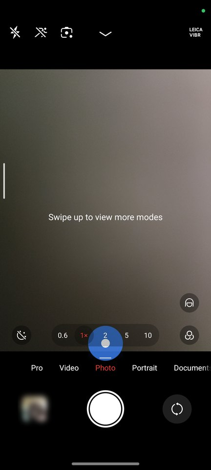
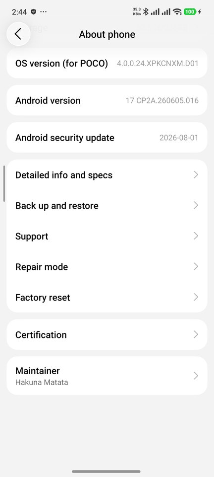

# HyperOS 4 · Android 17 for POCO F4 5G (munch)

An **unofficial** HyperOS 4 / Android 17 ROM for the **POCO F4 5G** (codename `munch`, also sold as Redmi K40S),
rebuilt on top of an existing community port with the official POCO F4 hardware layer, a Global (international)
setup, working telephony for every operator, and a long list of fixes, security clean-ups and performance work.

> [!CAUTION]
> **Only for the POCO F4 5G (`munch`).** Flashing it on any other phone will brick that phone. The install
> scripts refuse to run on anything that does not report `munch`.
>
> **Your own risk.** This is an unofficial ROM. You need an unlocked bootloader, a clean install erases all data,
> and things can go wrong (bootloop, lost data, a phone that needs a full official reflash). Nobody here is
> responsible for your device. Not affiliated with, endorsed by or supported by Xiaomi, POCO or Google.

| | |
|---|---|
| **Download** | [Releases](../../releases) — `POCO-F4-munch-HyperOS4-A17-T20261026` (zip in parts) |
| **Install guide** | [INSTALL.md](INSTALL.md) (Linux, Windows, macOS; commands included) |
| **Every change and why** | [ROM_HISTORY.md](ROM_HISTORY.md) |
| **Build it yourself / patch it** | [docs/BUILD.md](docs/BUILD.md) · rules for AI coding agents: [AGENTS.md](AGENTS.md) |

## Screenshots

| | | | |
|:-:|:-:|:-:|:-:|
|  |  |  |  |
| HyperOS 4.0.0.24, Android 17 | 8 GB (+8 GB virtual), SD870, kernel 4.19 | VoLTE + Wi-Fi calling per SIM | 5G / LTE / 3G / 2G choice |
|  |  |  | |
| Xiaomi HyperAI + Gemini | HyperOS 4 camera; green dot = camera in use | About phone | |

Personal data (phone numbers, photos) is blurred in the screenshots.

## Why this ROM exists

POCO F4 5G stopped at HyperOS 1 (Android 14). I wanted the newest HyperOS on my own phone, so I installed a
community HyperOS 4 port — and found purple night photos, a failing speaker, a slow and hot phone, China-only setup,
no updates, unencrypted storage, hidden spoofing hooks and a kill-switch. I fixed it layer by layer for my phone,
then made it work for every country and operator so others can use it too. Every change was researched first and
compared with the official POCO F4 software and the official Xiaomi 17 Global HyperOS 4 before it went in.

## What it is built on

| Layer | Version | Source |
|---|---|---|
| OS (system, system_ext, product) | HyperOS **OS4.0.0.24** (China base `XPKCNXM`), **Android 17** (`CP2A.260605.016`), security patch 2026-08-01 | Community munch port (ZynDong, t.me/munch_hyperOs), heavily modified here |
| Global layer (mi_ext, apps, regions) | Xiaomi 17 Global HyperOS 4 (`OS4.0.0.9.XPCMIXM`) | Official Xiaomi |
| Hardware layer (vendor, odm) | **Official POCO F4 HyperOS 1.0.9 Global** (`V816.0.9.0.ULMMIXM`), vendor patch 2025-04-01 | Official Xiaomi (camera, audio, fingerprint, thermal restored) |
| Firmware (modem, DSP, Wi-Fi/BT, TrustZone …) | Final official munch firmware (modem `MPSS.HI.2.5.1.c1`) — HyperOS 1.0.12 is byte-identical | Official Xiaomi |
| Kernel | `4.19.325-zyndong-perf` (KernelSU built in, not activated) | Community port |
| ABI | 64-bit with 32-bit support (`zygote64_32`) | — |

## Features

**HyperOS 4 / Android 17**
- HyperOS 4 interface, animations, HyperIsland, launcher, Control Center, Android 17 framework.
- Xiaomi **HyperAI**: Gemini, AI Writing, AI Translate Conversation, **AI Interpreter (live translation of phone calls)**,
  AI Subtitles; Circle to Search; Google app integration.
- Full **Global** setup: Google setup wizard, "Copy apps & data", region chosen in setup (226 regions), Global Xiaomi
  apps (Messages, Clock, Calculator, Recorder, Notes, Screen Recorder, Mi Share, Mi Music, Mi Mover, Wallpaper
  Carousel, Link to Windows …), Updater + System apps updater.

**Calls and mobile network (every country, every operator)**
- Preferred network type page (5G / LTE / 3G / 2G), manual carrier selection.
- **VoLTE, video calling and Wi-Fi calling** switches for every operator Xiaomi has a profile for: 625 VoLTE /
  532 Wi-Fi calling / 233 video-call entries in about 118 countries, built from Xiaomi's own carrier data.
- Complete APN list (Xiaomi's 4,905 entries + Global extras including IMS APNs), refreshed per release.
- Dual SIM; both Xiaomi Phone/Contacts and Google Phone can be used.

**Camera**
- Official POCO F4 camera tuning for all four sensors (OV64B40 main, OV8856 ultrawide, IMX596 front, GC02M1 macro),
  HyperOS 4 camera app.
- **GCam (LMC 8.4)** preinstalled with 13 configs for this phone, copied to `/sdcard/LMC8.4` automatically on first
  start; macro/ultrawide noise models and white-balance presets matched to the real sensors.

**Audio and Bluetooth**
- Official audio HAL; speaker, earpiece, wired and Bluetooth sound; A2DP offload with SBC, AAC, aptX, aptX HD,
  aptX Adaptive, LDAC and LHDC.

**Privacy**
- Green camera / microphone indicator in the status bar while an app uses them.
- No China tracker, no hidden spoofing (details below).

## Fixed compared with the original China port

| Problem in the original port | Fix |
|---|---|
| Purple night photos, red cast, portrait crash, "Xiaomi 17" watermark (wrong IMX582 camera tuning) | Official munch camera stack and tuning |
| Speaker short sounds failing (5,550 of 5,552) | Official audio HAL |
| No sound on speaker/Bluetooth (audio DSP crash loop from Google's hotword model) | Hotword engine taken out of the DSP config |
| Every outgoing call took the mobile network down until reboot | Phone service matched to the framework |
| Boot 70.7 s, 29 s of it rebuilding a stale boot image every boot | Stale image removed → **41.3 s** |
| Dead files in system/vendor images (unreadable links) | Image builder patched + checked on every build |
| China setup loop, Provision / Xiaomi Account crashes | Global setup |
| Empty network-type page, hidden VoLTE switch | Device features file + correct VoLTE property |
| No system updates, "Update apps" crash | Updater restored |
| Boot sometimes fell back to fastboot | Boot marked successful (A/B) |
| Crash loops (traced, atfwd), missing thermal profiles | Fixed / restored |
| Device shown as "Redmi K40S" | POCO F4 5G everywhere |

## Security

| Original port | This ROM |
|---|---|
| User data **not encrypted** | File-based + metadata encryption |
| Hidden porter reboot kill-switch (`vendor_security`) | Removed |
| Kaorios hook: attestation/keybox spoofing, anti-detection | Removed |
| China carrier self-registration app sending IMEI/IMSI/location (SystemHelper, Baidu SDK) | Removed |
| Privileged-permission allowlist off | **Enforced** |
| Permissive SELinux domains | All enforcing |
| FRP (anti-theft) off | On |
| ADB open without authorisation | ADB asks for authorisation; no pre-authorised keys |
| Root active with hiding | KernelSU is in the kernel but not activated; no root app |

Still true (disclosed, not fixable in a port): the bootloader stays unlocked (orange verified-boot state); the port's
framework keeps a signature-check bypass; `ro.boot.verifiedbootstate` and lock-state properties are set to
"green/locked" values; the vendor/firmware security patch level is 2025-04-01 (munch is end of life).

## Performance and hardware tuning

| | Original port | This ROM |
|---|---|---|
| Boot to screen | 70.7 s | **41.3 s** (first boot after an install ~60 s: the boot image is built once) |
| Zygote start → class preload | 29.5 s (stale boot image rebuilt in RAM every boot) | 0.15–0.8 s |

Raw before/after runs of `tools/bench.sh` (app start times, memory, jank) are in `audit/benchmarks/`; they were
taken at different uptimes, so only the boot numbers above are a like-for-like comparison.

- **CPU/GPU:** all 8 cores at full clocks (1.80 / 2.42 / 3.19 GHz), schedutil; Adreno 650 at 305–670 MHz.
- **Memory:** official heap values, USAP pool, 8 GB zram (lz4), background dexopt on the little cores.
- **Thermal:** official profiles including performance/game modes.
- **Boot preloading:** ART builds the boot image once on /data (odrefresh, signed by odsign) and reuses it; Android
  then preloads classes from it in about 1 s instead of compiling them on every boot.
- **Not yet in:** schedtune foreground boost (`secure_build/staging_sunday/`, prepared and pending a test).

## Kernel

`4.19.325-zyndong-perf` — the port's kernel, kept because it boots reliably. Built in: KernelSU (inactive), schedtune,
zram, all audio/Wi-Fi/fingerprint drivers (no separate modules). Not available: uclamp, binder freezer (app
freezer is limited), KVM (no Android virtualisation).

Four custom kernel builds from source (with uclamp, binder freeze, tracing, zram writeback) were made and tested;
none reached a stable boot, so they are **not** in this release. Notes and configs: [`secure_build/KERNEL.md`](secure_build/KERNEL.md).
A newer kernel will come only after a build passes a RAM-only boot test.

## Why it is not pure 64-bit

The phone's official hardware layer (Android 11-era kona vendor) runs nine programs as 32-bit, including the audio
service, the media codec service, Miracast, the Xiaomi virtual SIM and antenna control. 64-bit replacements for the
two important ones were built and work, but a full 64-bit-only build did not boot and was shelved. This ROM therefore
runs 64-bit apps with 32-bit support (`arm64-v8a, armeabi-v7a`), which also keeps older 32-bit apps working.

## Known limits

| Item | Reason |
|---|---|
| "Hey Google" voice wake | Google's wake word only runs on the audio DSP; with this kernel it crashes the DSP (no sound at all), so it is off. Open Assistant/Gemini with a long press on the power button or a swipe from a bottom corner |
| "Device not Play Protect certified" after setup | No HyperOS 4 build for munch is certified by Google. Register your phone with Google (free, official): [INSTALL.md → Google certification](INSTALL.md#google-play-protect-certification) |
| Banking / DRM apps may refuse to run | Unlocked bootloader; Play Integrity "device" checks can fail |
| Xiaomi dialer call recorder | Off in the Global build (Google Phone records where the law and Google allow) |
| VoLTE on some operators (e.g. Banglalink) | Network-side handset whitelist, not the ROM |
| Gemini Nano, UWB, satellite, LE Audio, Leica | Not supported by the SD870 hardware or certification |
| Security patch of vendor/firmware 2025-04-01 | munch is end of life; no newer official firmware exists |
| Fingerprint, 120 Hz | Official HAL/display config are included; the developer's phone has a damaged fingerprint flex and a 60 Hz replacement panel, so these two were not tested on original parts |

Sensors: 69 sensors are present (LSM6DSO accelerometer/gyroscope, AK0991x magnetometer, TCS3701 light/colour,
Elliptic ultrasonic proximity, Semtech SAR, Xiaomi virtual sensors). GPS, NFC, IR blaster, vibration with amplitude
control and all 7 camera devices work.

## Install (short)

1. Unlock the bootloader (official Mi Unlock; see the guide).
2. Install Android platform-tools, download all release parts, join them, check the checksums.
3. Phone in fastboot mode → `bash flash_linux.sh` (Linux/macOS) or `flash_windows.bat` (Windows).
4. First boot 3–5 minutes. Register the phone with Google if it says "not certified".

Full steps, commands, updating, rollback and troubleshooting: **[INSTALL.md](INSTALL.md)**.

## For developers

- Images are rebuilt from the base images plus `secure_build/payload_tele/` with `secure_build/build_tele.sh`
  ([docs/BUILD.md](docs/BUILD.md)). Updates can be shipped as single partition images (patches) and flashed with
  `flash_*.sh update` without wiping.
- Using Codex, Claude Code or another AI agent on this repo: it should read [AGENTS.md](AGENTS.md) first — it lists
  the rules that come from real failures (image builder, SELinux, system apps, overlays).
- Research reports (hardware, firmware, telephony, camera, apps, performance): `audit/research/`.

## Credits

- Original munch HyperOS 4 port and kernel: ZynDong (t.me/munch_hyperOs; the port package names @jnt100).
- Xiaomi / POCO for HyperOS, the official munch firmware and vendor; Google for Android and GMS.
- GCam LMC 8.4 by Hasli; configs by BubNois, Sachin Rai (Pixel Perfect), KCPD and the POCO F4 community.
- This build: Hakuna Matata (maintainer).

HyperOS, MIUI, POCO and Xiaomi are trademarks of Xiaomi; Android and Google are trademarks of Google LLC. The ROM
contains their software unmodified or repackaged; this repository's own scripts, tools and documents are provided
as-is, without warranty.
